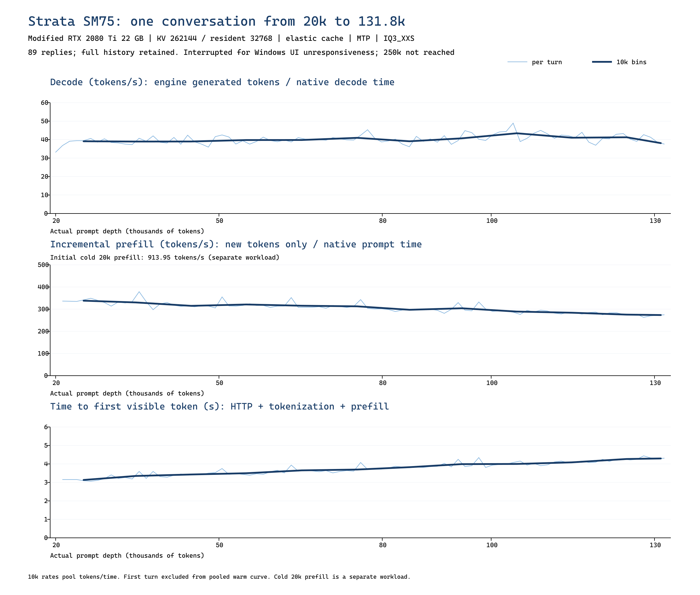

# Conversazione cumulativa 20k → 131790 — 2 ottobre 2026

**Prova interrotta: Windows non era piu' cliccabile. Target250k NON raggiunto.** Strata e' stato fermato al termine del turno corrente; non attribuire questo arresto a un errore di inferenza.

Daily f469, 89 turni, 22920 token generati; contesto reale 19999 → 131790.

RTX2080Ti modificata a22GB, Ryzen7 5800X,96GB RAM. KV262144/int8/resident32768, cache auto/elastica, MTP, nessun carico artificiale.

Dossier iniziale da20k con documentazione reale Strata, poi estratti nuovi da circa1000token per messaggio utente. Tutte le risposte effettive conservate nella cronologia, nessuna troncatura o riavvio intermedio.

Primo prefill freddo: **913.95t/s**, TTFT22.05s. Le righe seguenti misurano il prefill incrementale e il decode.

| Contesto circa | Turni nella finestra ±5k | Prefill incrementale t/s | Decode t/s | TTFT medio s |
|---:|---:|---:|---:|---:|
|20k|3|335.72|38.37|3.16|
|50k|8|318.59|39.20|3.50|
|80k|8|304.47|39.87|3.81|
|100k|8|298.24|43.46|3.99|
|130k|6|272.19|39.88|4.30|

Velocita' aggregate come somma token / somma tempi nativi; prima richiesta esclusa dalle finestre warm. TTFT misurato al primo contenuto visibile nel flusso HTTP.

Risposte terminate: {'stop': 89}. Slot esperti effettivi: 6504–6991, ricostruiti dal log nativo; la metrica engine riportava gli slot iniziali. Temperatura GPU: 51–62°C.

CSV e summary JSON contengono ogni punto, MTP, riuso, cache, telemetria e limiti. Gli esempi sono risposte reali del modello; la correttezza tecnica generale non e' stata valutata.

Questa e' una curva osservata durante una singola conversazione. Cambiano testo, accettazione MTP e cache. Il prefill da1k con riuso non e' confrontabile direttamente col prefill freddo da131k/250k. Nessuna misura fisica GB/s DRAM.

Tutti i processi di questa prova sono chiusi al termine della corsa. Nessuna modifica al daily o alla combinazione di kernel.
