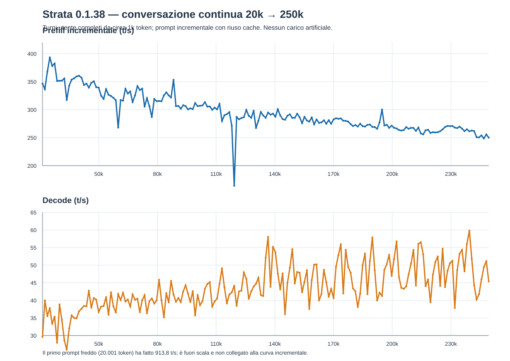

# Conversazione continua 20k → 250k su Strata 0.1.38

Prova completata in 30.5 minuti: 187 turni, contesto 20,001 → 250,012 token. Daily binary SHA-256: `13ee1a89be497ad83c67f62553b1133fec2a8d9309230d43a9dae639d89008a5`.

RTX 2080 Ti modificata a 22 GB, Ryzen 7 5800X, 96 GB RAM; KV int8 con capacità 262.144, residenti 32.768, cache esperti auto/elastica e MTP. OktoCGControl era aperto. Nessun carico artificiale, profiling, nuova build durante la prova o troncamento della cronologia.

È stata una sola conversazione: dossier iniziale di 20k token ricavato da sorgenti e documentazione reali, poi messaggi nuovi da circa 1k token che richiamavano la risposta precedente e aggiungevano altri estratti. Le risposte sono rimaste nella cronologia per tutti i 187 turni.

Primo prompt freddo: **913.8 t/s**, TTFT 22.06 s, decode 25.4 t/s. Sui 186 turni successivi: prefill aggregato **291.4 t/s**, decode aggregato **42.9 t/s**, TTFT medio 4.08 s. La curva seguente esclude il primo prompt freddo e l’ultimo messaggio più corto (451 token utente), così il grafico confronta follow-up completi da circa 1k.

| Contesto circa | Turni completi nella finestra ±5k | Prefill incrementale t/s | Decode t/s | TTFT medio s |
|---:|---:|---:|---:|---:|
| 20k | 4 | 361.6 | 35.4 | 3.10 |
| 50k | 7 | 336.6 | 38.9 | 3.26 |
| 80k | 8 | 313.8 | 40.1 | 3.62 |
| 100k | 8 | 306.2 | 40.1 | 3.73 |
| 130k | 8 | 287.8 | 43.2 | 4.12 |
| 160k | 8 | 280.2 | 44.4 | 4.29 |
| 200k | 8 | 268.0 | 49.4 | 4.57 |
| 230k | 8 | 268.9 | 48.1 | 4.76 |
| 250k | 4 | 252.1 | 47.9 | 5.09 |

La media warm usa somme di token/somme di millisecondi e include l’ultimo segmento parziale; la tabella e il grafico includono solo i messaggi utente completi di circa 1k. Il segmento finale ha raggiunto 250.012 token con 451 token utente nuovi. La curva è una singola conversazione e non è direttamente confrontabile con prefill freddo di un prompt unico.

GPU: 47–62 °C; slot esperti osservati 6490–7588; KV streaming hit in VRAM finale 95.57%. I contatori KV sono cumulativi e non misurano direttamente la banda DRAM fisica. Nessuna valutazione completa di correttezza tecnica delle risposte.

Artefatti: `curve.csv` (tutti i turni), `summary.json` (aggregati e telemetria), `conversation-samples.json` (tre campioni). La trascrizione integrale resta nel workspace locale `.codex_runs` e non è inclusa qui.
